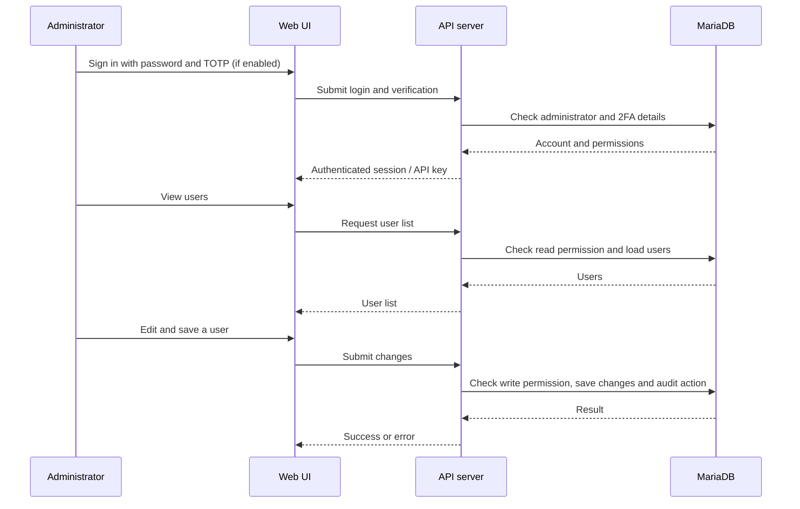
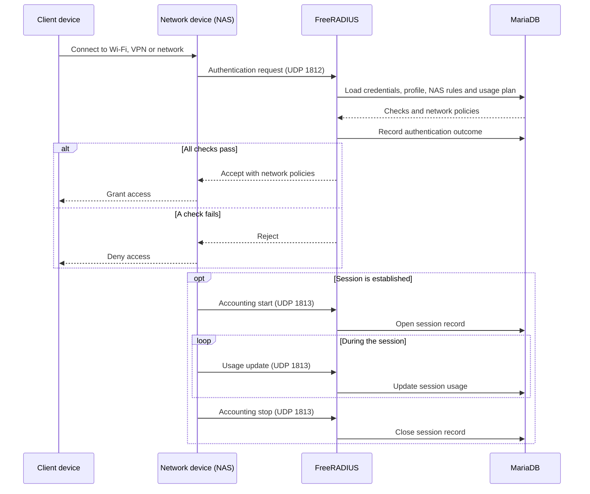
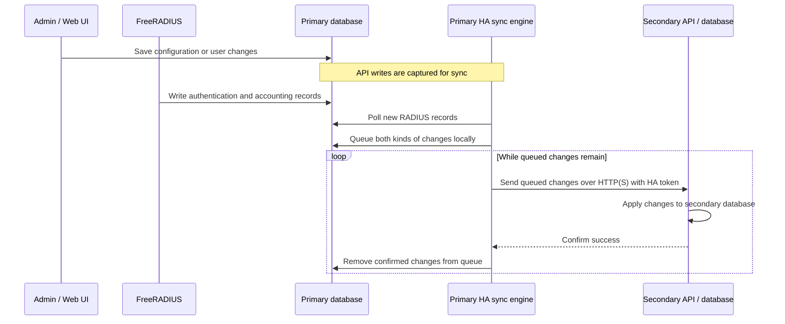

# RadiusStack Documentation

Welcome to the RadiusStack Wiki! This guide covers everything from deployment to daily administration. 

## Table of Contents
1. [Overview](#overview)
2. [Architecture](#architecture)
3. [Installation, Deployment & Upgrade](#installation--deployment)
4. [High Availability](#high-availability)
5. [Features & Guides](#features--guides)
   - [Multi-Tenancy](#multi-tenancy)
   - [Managing Users & TOTP 2FA](#managing-users--totp-2fa)
   - [MAC Authentication](#mac-authentication)
   - [Profiles & Custom Attributes](#profiles--custom-attributes)
   - [COA & POD](#COA--POD)
   - [Usage Plans](#usage-plans)
   - [NAS Clients](#nas-clients)
   - [Administrators & 2FA](#administrators--2fa)
   - [Certificates (EAP/SSL)](#certificates-eapssl)
   - [RadSec](#radsec)
   - [Downstream-proxy](#downstream-proxy)
   - [Log Forwarding](#log-forwarding)
   - [Database Backup & Restore](#database-backup--restore)
   - [Reporting and analyitcs](#Reporting-and-analyitcs)
   - [API schema and tester](#API-schema-and-tester)

---

## Overview
RadiusStack is a powerful, self-contained AAA (Authentication, Authorization, and Accounting) platform built on FreeRADIUS 3, MariaDB, and a custom Node.js API backend. It removes the steep learning curve traditionally associated with FreeRADIUS by providing an intuitive Web UI and a fully documented REST API. 

It supports EAP (PEAP + TTLS) with PAP, CHAP and MSCHAPV2 out of the box, suitable for WIFI (WPA-Enterprise) authentication, and is pre-configured to copy reply attributes from the inner to outer packet for NAS visibility, e.g dynamic VLAN assignment.

The system relies on Docker containers, ensuring clean isolation and high portability across any host machine. 

## Architecture
Instead of using custom container images, the platform is purposfully built using official container images. Initialization and container configuration is performed during deployment. The platfom conisits of 5 containers which are all deployed using a single docker compose script.
Containers can be upgraded in-place by re-running the docker compose script.
* **Radius Server:** The freeradius version 3.x server.
* **Database Server:** MariaDB server. Used by the radius server and API server.
* **PHPMyAdmin:** A web frontend for direct managment access to the backend database. Warning - access to this serivice should be restrried
* **Node.js APi Server:** The backend API server
* **WebUI:** The WebUI frontend. All the functions in the WebUI are API calls via the API server.

**Application:**

**RADIUS:**


## Installation & Deployment

### Prerequisites
* Docker and Docker Compose installed.
* Ports `1812/udp` (Auth), `1813/udp` (Acct), and `80/443` (Web UI/API) available on your host.

### Quick Start
1. Clone the repository to your host machine:
   ```bash
   git clone https://github.com/deangoldhill/RadiusStack.git
   cd RadiusStack
   ```
2. Optionally use the interactive 'setup_env.sh' script to set vairables or rename '.env.example' to '.env' and edit it to set your desired passwords, keys and settings.
3. Bring the stack online:
   ```bash
   docker compose up -d --build
   ```
4. Access the Web UI at `http://<your-server-ip>`.
5. Login with the default credentials (`admin` / `admin`).

### Upgrade
Make sure the upgrade.sh script in the root directory has executable permission
<br/>
./upgrade.sh --to [desired version]
<br/>
E.G ./upgrade.sh --to 6.0.1
<br/>
The upgrade script produces a very detailed debug log and creates a backup in the 'upgrade-backups' folder. If the upgrade fails it will attempt to restore the pre-upgrade instance but will not start it, you must do that manaully. in some cases it may be nessesary to manually restore from the automated backup.
If you experiance an upgrade failure, please raise a ticket.

## High Availability
# High Availability (HA) Architecture

RadiusStack features a built-in, application-layer High Availability (HA) sync engine. Instead of relying on complex third-party database replication), RadiusStack natively handles its own state synchronization over standard HTTP/REST APIs.

This allows you to deploy a **Primary Node** (Active) and a **Secondary Node** (Standby) across different physical locations, subnets, or data centers without exposing direct database ports (3306) across the WAN.
The secondary node webui is read-only. You can promote it on the settings page but you should only do this when absolutely nessesary to avoid conflicts.
The secondary node can process radius requests and will sync logs and accounting to the primary.
HA controls in the settings page are as follows:
Perform full sync - this will sync the entire system including settings and logs. You can use this completely rebuild the secondary node from a fresh install or migrate from a standalone to HA setup, or to resync after recovering from a communication failure.
Pause sync - This may be useful during upgrades or solving a data conflict.
Reconsile log data - in the event that log/accounting data has been intentially removed from the primary but still exists on the secondary, for example log purging, clearing sessions etc. during a sync communication outage, the normal sync function or full sync action would not delete the data from the secondary. This action will remove all log data from the secondary and sync from the primary to get it back in sync. You must pause sync to perform this action. 

---

## How the Sync Engine Works

Because RadiusStack receives database writes from two completely different sources (Admin actions in the WebUI and Network Access actions from FreeRADIUS), the HA Sync Engine uses a **dual-capture architecture**:

1. **API/WebUI Writes (The Interceptor):** Any change made by an Administrator (e.g., creating a user, assigning a profile, updating settings) is intercepted natively at the Node.js database pool layer. The exact SQL query is captured and pushed directly to a local `ha_queue`.
2. **RADIUS Writes (The Poller):** Because the FreeRADIUS daemon writes to the database directly (bypassing the Node API), a background worker continuously monitors the `radacct` and `radpostauth` tables for new IDs and timestamps. When it detects new network activity, it converts the rows into SQL statements and pushes them into the `ha_queue`.

Once queued, the Primary Node packages the queries and transmits them securely to the Secondary Node's API, which executes them in perfect parity (automatically bypassing auto-increment offsets).

---

## HA Execution Pipeline

The sequence diagram below illustrates how both Admin changes and Network activity are unified into a single, secure HA transit pipeline.



---


## Configuration & Environment Variables

To enable High Availability, you must configure the HA variables in your `container_config.env` file on both servers. 

### Primary Node Configuration
The Primary Node accepts all incoming writes and is responsible for pushing data to the peer.
```env
HA_ENABLED=true
HA_ROLE=primary
HA_DB_OFFSET=1   # Set to 2 on the secondary node
HA_PEER_IP=192.168.1.51
HA_API_TOKEN=changeme_api_sync_token

```

### Secondary Node Configuration
The Secondary Node operates in **read-only** mode for the WebUI. It rejects standard API writes and only accepts replicated SQL payloads from the Primary Node that include the matching `HA_API_TOKEN`.
```env
HA_ENABLED=true
HA_ROLE=secondary
HA_DB_OFFSET=2   # Set to 2 on the secondary node
HA_PEER_IP=192.168.4.50
HA_API_TOKEN=changeme_api_sync_token

```

> **Security Note:** Ensure your `HA_API_TOKEN` is a long, cryptographically secure string (e.g., generated via `openssl rand -hex 32`). Do not expose port 3000 on the Secondary Node to the public internet without a reverse proxy (like NGINX) enforcing HTTPS.

---

## Failover & Promotion

If the Primary Node goes offline, the Secondary Node contains a perfect, up-to-date replica of your RADIUS environment. 

By default, the Secondary Node's WebUI is locked in read-only mode to prevent split-brain database scenarios. To promote the Secondary Node to become the new Primary (allowing you to make Admin changes), you can send an API request to the promotion endpoint:

In the settings page, click 'promote to primary'

Or via API:
```bash
curl -X POST http://<SECONDARY_IP>:3000/api/ha/promote \
     -H "Authorization: Bearer your-admin-api-key"
```

## Features & Guides

### Multi-Tenancy
Multi-tenancy is always enabled by design, even if it is not your intention to use it.<br/>
The global tenant is for system wide configuration and visibility like HA, container management and debug. It is not intended to be a service tenant.<br/>
On a fresh install, in addition to the global tenant, a default tenant is created, which is a service tenant.

### Managing Users & MFA
The **Users** page is where you to create users and assign profiles and usage plans.<br/>
RadiusStack supports MFA using TOTP. for example using the Google or Microsoft authenticator app.
- **To Enable:** Tick the TOTP option next to a user. This generate a unique one-time registration code and a registration URL which should be provided to the user.
*By default the registration code is valid for 24 hours, but can be modified in the settings page.
- **Registration:** The user must use the link to access the registration portal. They must provide the registration code and password and then will be shown a QR code to import. Once imported, the user must enter the one-time code from the app to complete registration.
- **Authentication:** Once registered, the user authenticates by appending the one-time code directly to the end of their normal password (e.g., `password123456`).
Note - MFA only works with PAP authentication protocol. 

### MAC Authentication

RadiusStack supports MAC Authentication which is where the NAS device acts as the supplicant and uses the connecting devices MAC address as the username and password. <br/>
This is useful for authenticating devices for WIFI or Dot1X that do not have a supplicant. (e.g., Printers, Phones, IoT devices).<br/>
VLAN assignment, usage limits and other features are still possible with MAC authentication.<br/>
You can enable the 'Auto MAC registration' feature in the settings page which will automatically create MAC device objects for new devices and optionally apply a defined profile and usage plan. <br/>
In RadiusStack, a MAC auth device is treated similar to a standard user. <br/>
The format in which the MAC address is sent (E.G aa:bb:cc:dd:ee:ff, aa-bb-cc-dd-ee-ff, aabbccddee) can vary by NAS device and some may support multiple formats. RadiusStack support the 3 formats in the example above. Colon separation is the most common and is recommended where possible.

### Profiles & Custom Attributes
Profiles act as permission groups for your users. Instead of configuring attributes for every single user, you create a Profile and assign users to it.
- **VLAN assignment:** specify a VLAN ID. All supporting attributes for dynamic VLAN assignment will automatically be added.
- **Reply Attributes:** You can inject any standard FreeRADIUS dictionary attribute (e.g., `Filter-Id`, `acct-interim-interval, Vendor-Specific`). Select from a list of commonly used attributes or add additional attributes to the list via the settings page.
- **NAS Restrictions:** You can optionally lock a profile so its users can only authenticate from a list of specific NAS IP addresses.
*In a standard radius deployment, only 1 NAS-IP-Address check attribute can be specified. But RadiusStack uses a custom ULANG policy that allows multiple IP addresses to be listed in the profile, a match of any one will be accepted.

### COA & POD
Change of Authorisation (CoA) and Packet of Disconnect (PoD) are special packets sent by the Radius server on UDP port 3799 to the NAS to disconnect or modify access permission for active sessions.<br/>
If a user's settings are changed like VLAN assignment or exceeds usage limits, changes will only apply on the next session which in some cases may be a very long time. These packets tell the NAS to update the session (CoA) or force a reconnect (PoD) to make these changes apply immediately.<br/>
RadiusStack supports the following methods:<br/>
Enable automatic PoD upon usage depletion in a usage plan - this will send a PoD packet when a user exceeds their limits.<br/>
On-demand CoA or PoD from the active sessions page.<br/>
Support for these packets vary by NAS device type and vendor. Most vendors align to RFC 5176 but some may not.<br/>
Some vendors may require certain attributes to be sent. This can be configured in the NAS object under 'Advanced: CoA / PoD packet attributes'


### Usage Plans
Usage plans can be assigned to users and MAC auth devices to enforce data and or time limits.<br/>
When usage limits have been exceeded, authentication requests will be rejected until the cycle is automatically or manually reset.<br/>
- **Data/Time Caps:** Define limits such as "10 GB data" or "24 hours connection time".
- **Reset Cycles:** Set plans to reset automatically (`daily`, `weekly`, `monthly`) or `never`.


### NAS Clients
The **NAS** (Network Access Server) defines which network devices are permitted to send Radius requests to RadiusStack.
- Add switches, firewalls, or Wi-Fi access points by IP address.
- Set a strong, shared `Secret` key which must be mirrored on the client device. 
- The FreeRadius service will be automatically restarted whenever a NAS device is added or edited, this is necessary for the changes to take effect. 

### Administration
The **Adminstrators** tab manages who has access to the RadiusStack Web UI and REST API.
- **Granular Permissions:** You can restrict admins to specific modules (e.g., allow an admin to manage Users, but not profiles and Settings) and grant read-only or read-write permission.<br/>
An administrator with the 'platform super administration' role can assign permission to one or more tenants, while a tenant specific administrator can only assign permission to tenants which they have permission to.<br/>
- **2FA Enforcement:** You can toggle 2FA on a per-admin basis, or you can enforce MFA for all administrators assigned to a tenant including the global tenant. When enabled, the administrator will be forced to register MFA and will be required to provide a one-time code in a second stage login page.<br/>
- **API Keys:** Every admin has a unique `X-API-Key` that can be regenerated at any time for programmatic access.

### Certificates (EAP/SSL)
For tunneled authentication protocols (PEAP & TTLS), TLS certificates are used to establish the tunnel and for the client to authenticate the server.<br/>
RadiusStack automatically generates a 10 year certificate and enables EAP on first use.<br/>
You can generate a new CA certificate with custom attributes or import a custom certificate in the global tenant settings page.<br/>
Some devices may enforce validation of the server certificate by importing the CA certificate. This can be downloaded in the settings page.

### RadSec
Radsec (RFC 6614) is a protocol that runs over TCP port 2083 with the purpose of encrypting Radius traffic using mutual TLS.
The entire data channel between the NAS client and the Radius server is encrypted, making it safe to traverse public networks.
RadiusStack makes Radsec very easy to setup and manage
1. Enable Radsec on the tenant setting page and provision a CA (this is synced to the secondary HA member)
​2. Create or edit a NAS client object, enable Radsec and save the NAs client before trying to generate the certificate.
3. Edit the NAS client again, select either a combined key & certificate (P12) or separate files depending on the type of NAS and what it wants. Click 'generate client certificate', download the client certificate & key and the tenant CA certificate. take a note of the private key passphrase.
3. Enable Radsec on the NAS client, upload the client certificate and tenant CA certificate.
You can use the [Radsec Test Tool](https://github.com/deangoldhill/Radsec-Test-Tool) to test the radsec implementation. The tool will act as the NAS client and the end user. 

### Downstream-proxy
Downstream proxy is a feature to proxy requests to a downstream Radius server. Useful for shared service providers, identity providers or long term data storage.<br/>
You can select to proxy authentication, accounting or both.<br/>
You can enforce proxy either in the NAS client which will proxy every request sent from that NAS, or in a profile which will apply to users or MAC auth devices assigned to that profile.<br/>
You can select Duplicate, which will process the request locally and proxy the request, with a further option of 'Validate Downstream Response' in which case the request must be accepted by the local server and the downstream Radius in order to return an accept response to the NAS.<br/>
Or you can select proxy only, which will log the request locally but will honour the response from the downstream Radius server only. It will not process the request locally.<br/>
First define downstream radius server objects in the downstream Radius tab.<br/>
Enable proxy either in a NAS or profile. <br/>
in the event of a conflict, the setting in the profile will take precedence.

### Log Forwarding
Log forwarding can be configured in the global tenant to forward authlogs and audit logs to a syslog server or SIEM.<br/>
Enable the feature, specify the destination IP address or hostname and select the desired format.<br/>
This will apply to all tenants.

### Database Backup & Restore
Located in the **Settings** page. Backup is exported in JSON format with two options
- **Full Backup:** Generates a full database backup including all objects, settings and accounting / authentication / audit logs.
*Note - full backups may fail to restore if imported to a different version as the database schema may be different.
- **Object Backup:** Generates a partial backup of users, profiles, plans and NAS clients. and optionally include accounting / authentication / audit logs. This contains most of the data needed to restore the server.
- The partial backup should safely import to different versions because the structure of these tables should never change.
- **Backup Restore:** Upload a previously generated backup. RadiusStack intelligently maps the columns, ignoring obsolete schemas to prevent database crashes when upgrading to newer server versions.

### Reporting and analytics 
- **Dashboard:** The dashboard show most recent active sessions authentication logs. Click an active session to view full details of the session.
- **Auth Log:** View Authentication logs with search capability. This log will also show authentication attempts of unknown users.
- **Accounting: View accounting records both active and closed. Filter by username, NAS client and date/time range. Click an accounting record to view full details.
*You can also purge accounting records for the specified filter scope.
- **Audit Log:** The Audit Log tracks every action taken by Administrators (creations, deletions, setting changes). It shows the origin (webUI, API, System), result (success, failed, denied) and action attempted.
*Filter by date range, result or search for action keywords.
- **Reports:** The top of the reports page shows the heaviest users by data usage and session time.
*The failed authentication report lists unique users with failed authentication by count, useful for detecting brute force attacks.
*The user-specific report generates a detailed report of activity for a specific user including top sessions, total requests, total data and session time for the specified date range.
- **Module Stats:** Click an object in the users, MAC Auth, Profiles and Plans pages to view related stats
- **Container logs: All containers are configured to redirect service logs to the container logs. View the container logs from the settings page.

### API schema and tester
- ** API schema:** The API Docs page lists the entire API schema
- **Interactive API Tester:** Click one of the API endpoints to pre-populate the tester with the correct URL and modifiable sample data. Optionally generate a curl command to test the API call from a different host.
*The API tester automatically uses the API key for the logged in administrator